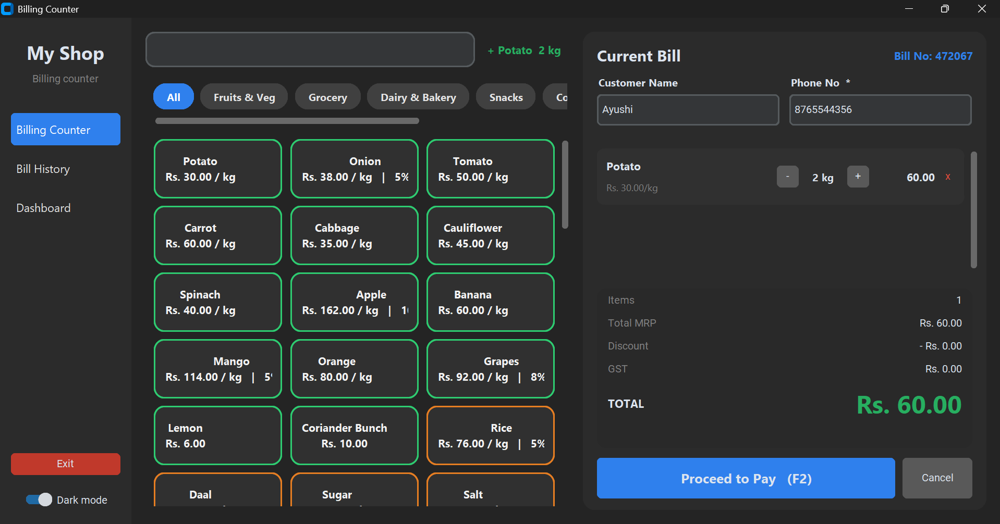

# 🛒 Billing Counter – Retail Billing System (Python)

## 📌 Project Overview

This is my **Diploma Final Year Project**, developed from **January 2024 to May 2024**.

It is a desktop billing application for a supermarket or mall counter, built with Python. The cashier adds products, enters the customer's phone number, takes payment by cash or UPI QR code, and prints the bill. Every sale is saved in a database and can be searched later.

## 🚀 Features

* Modern billing counter with product cards, search and category filters
* 70+ products with MRP, discount % and GST
* Weight-based billing for loose items (250 g, 500 g, 1 kg or any custom weight, and litres / ml)
* Live bill with Total MRP, Discount, GST, Final Total and "Customer saves" amount
* Customer name and phone number, with auto-fill for returning customers
* Cash payment with change calculation
* Online payment with a UPI QR code for the exact bill amount
* Random 6-digit bill number for every sale
* PDF bill / invoice for printing
* Bill history with search by bill number, name or phone number
* Sales dashboard with today's sales, total revenue, top-selling items and category-wise revenue
* Dark and light theme

## 🛠️ Tools & Technologies

* Python 3
* CustomTkinter (GUI)
* SQLite (Database)
* ReportLab (PDF bills and QR code)
* Pillow (Images)

## 📈 How It Works

1. Tap a product to add it to the bill. For loose items, choose or type the weight.
2. The bill updates live with price, discount and GST.
3. Enter the customer's phone number (name is optional).
4. Choose the payment method:
   * **Cash** – enter the cash received and the app shows the change.
   * **Online** – the customer scans the QR code and pays.
5. The bill is saved, and the PDF opens for printing.

## 📂 Project Structure

* 'app.py' – Main application and user interface
* 'db.py' – Products, prices, discount and GST logic, and database
* 'invoice.py' – Bill text, PDF invoice and UPI QR code
* 'requirements.txt' – Python libraries needed
* 'README.md' – Project documentation
* 'Dashboard_Screenshot.png' – Application preview

'billing.db' and the 'bills/' folder are created automatically when the app runs.

## ▶️ How to Run

1. Install Python 3.9 or newer (tick **Add Python to PATH** on Windows).
2. Install the required libraries:

```
pip install -r requirements.txt
```

3. Run the project:

```
python app.py
```

Products, prices and discounts can be changed in 'CATALOG' inside 'db.py':

```python
("Rice", 80, 5, "kg"),     # name, MRP, discount %, unit
```

> The prices and discounts in the project are sample data.

## ⚠️ Limitations

* The app cannot confirm an online payment automatically. The cashier checks the UPI app or SMS and then presses **Payment received**.
* Single counter and single user. There is no login or stock management yet.

## 🔮 Future Scope

* Stock / inventory tracking
* Barcode scanner support
* Cashier login
* Returns and refunds
* Automatic payment verification
* Export sales reports to Excel

## 🎯 Learning Outcomes

Through this project, I learned:

* Building a desktop application with Python and CustomTkinter
* Designing and using an SQLite database
* Applying discount, GST and weight-based price calculation
* Generating PDF bills and UPI QR codes
* Designing a clean, easy-to-use billing screen

## 📸 Preview



## 👨‍💻 Author

Ayushi Singh
Diploma in Computer Science – Shri RamSwaroop Memorial University, Lucknow
Final Year Project | January 2024 – May 2024
